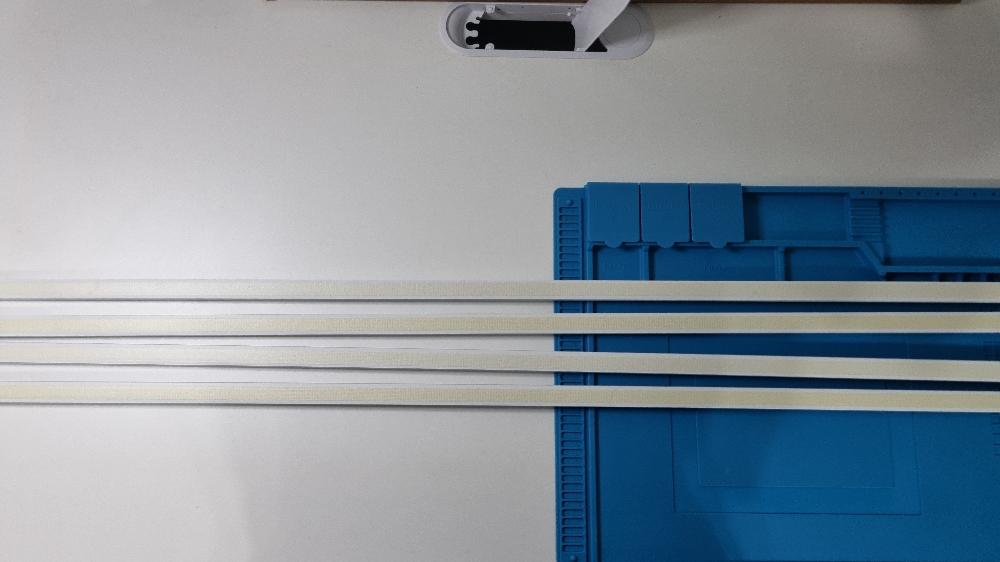
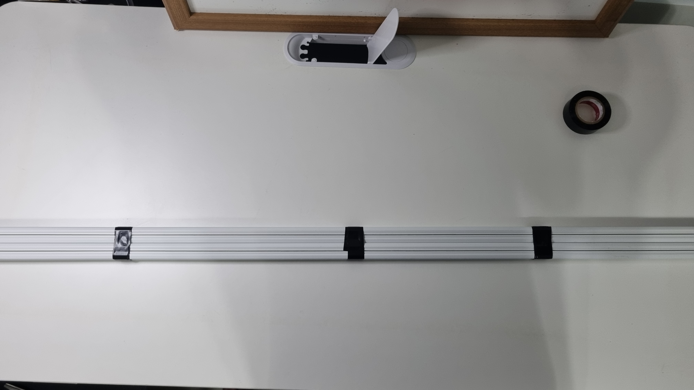
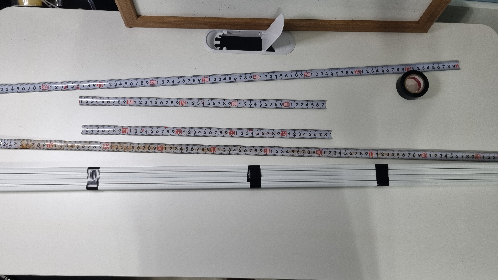
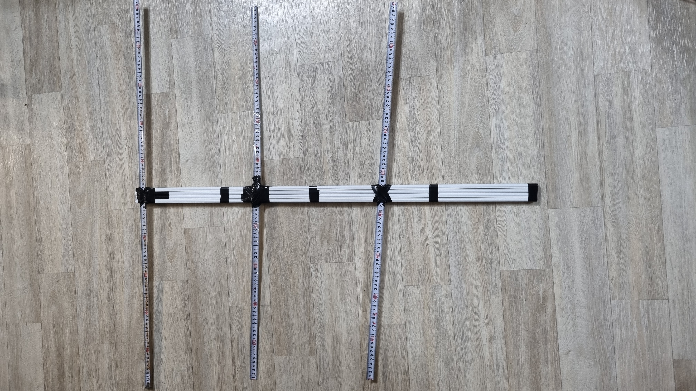
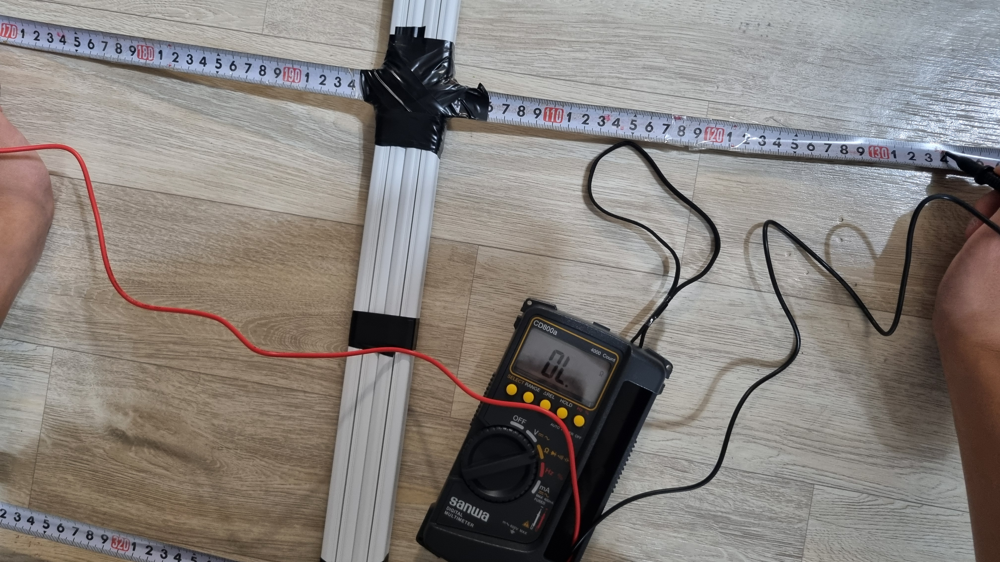
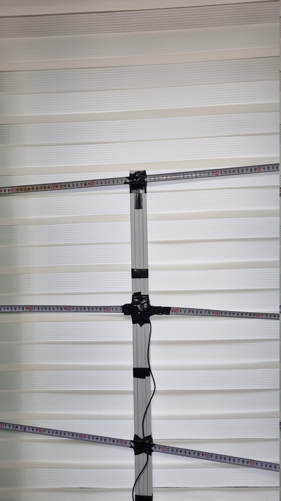
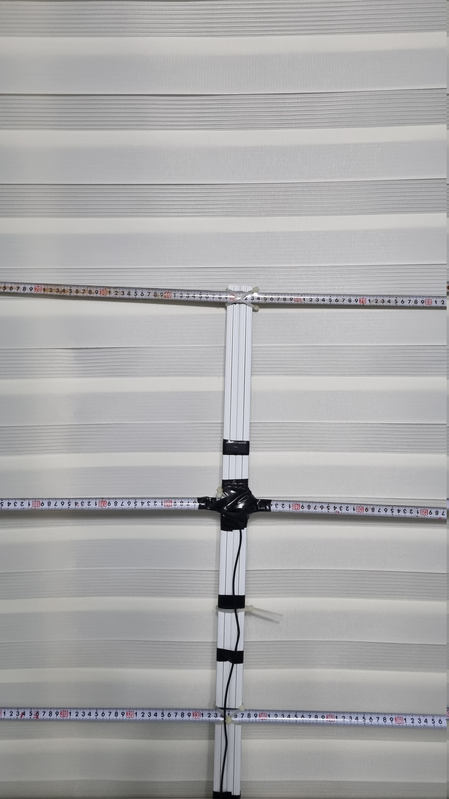
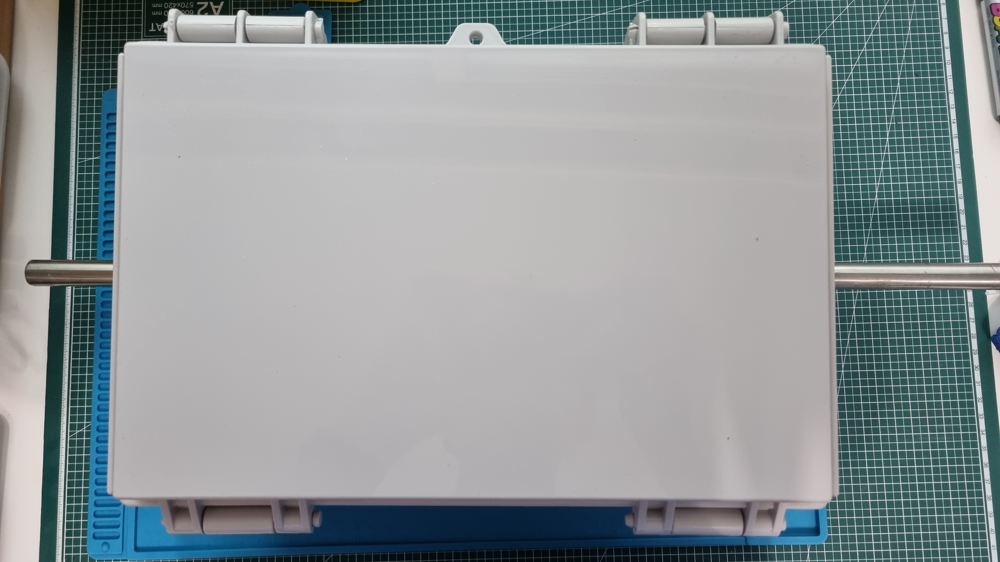
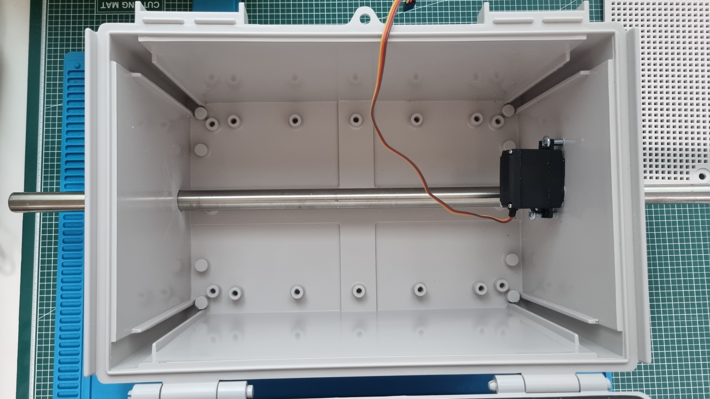
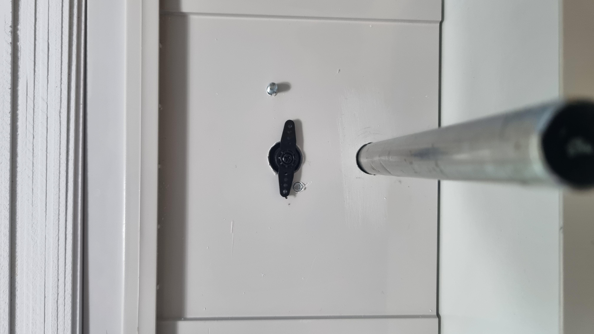

# Project : Making antenna for ISS [Log]

I was just watching saveitforparts’s video about Hearing The ISS. And I wanted to do that things. So I decided to make antenna for ISS.

Core IDEAs :
- 0. Receiving ISS’s signal (Astronaut’s voice)
- 1. Auto-Tracking

## 2026-10-14 : Brainstorming
Today, I am just going to think about some ideas.
1. I will use Yagi-antenna.
2. This project needs Auto-tracking function so I will use some servo motors and stepper motors.

So, I need to buy some servo motors and step motors and PVC pipe and SMA connector and measuring tape.

## 2026-10-16 : Making antenna (1)
Today, I made the **Yagi antenna**.
This is how I made it :

First, I made an insulator pole by attaching a wire protector.

Second, I cut the tape measure to the correct figure.

- **Reflector** : 102cm
- **Driven Element** : 48.5cm * 2
- **Director** : 90cm

The spacing between all components is 30cm.

As a beginner, these values come from Internet. So, I need to research ""How these values were calculated?""

Third, I used a multimeter to check the two parts of the Driven Element were not shorted together.

And the shown value was *OL* which means **Over Limit**. So, the Driven Element were not shorted together.

## 2026-10-21 making antenna (2)
Now, antenna is done!!

In October 21, honestly, I broke my SMA cable. (When I was stripping wire)
So, I bought a new **SMA cable**.
And, connect to each Driven Element.

But I found that the angle of each component don't match!
So, I decided to change insulating tape to **cable tie**.

Later I need to discover some servo motors and step motors, and a way to mount an antenna.

## 2026-10-28 , 2026-10-30 , 2026-10-31 , 2026-11-1 : Making auto-tracker (1)

To make auto-tracker I bought some materials.
- **MG996R servo motors**
- **NEMA 17 stepper motors**
- **Arduino Uno**
- **LM2596 step-down DC-DC voltage regulator**
- **PVC foam board** * 24
- **Enclosure**
- **lazy susan bearing**
I made a hole using a screwdriver on Enclosure and inserted pole and servo motor.

Also I wanted to use pole as a supporter and servo motor as a motor.
But, if there is a 2 axis of rotation on one pole, it can't rotate.
So I tried many things like 4-bar-linkage,Crank-Rocker Mechanism.
Failed.

So I thought about many structure. And decided to use structure called Cable-Driven Mechanism.

